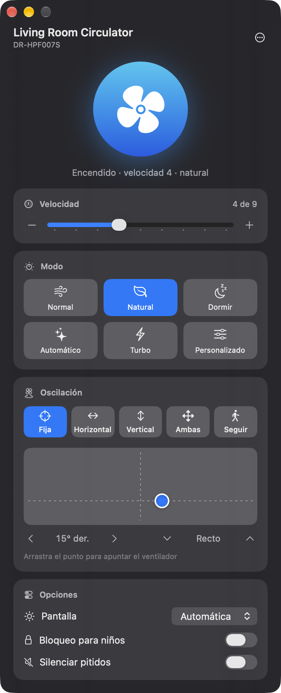

# Breeze for Dreo

App nativa de macOS para controlar tus ventiladores Dreo desde la Mac.
No oficial: no tiene relación con Dreo.

[English](README.md)

<p align="center">
  
</p>

## Qué hace

- Encender y apagar, velocidad y modos (Normal, Natural, Dormir, Automático, Turbo, Personalizado…)
- Oscilación fija, horizontal, vertical, ambas o Seguir (SmartFollow)
- Un panel de dirección que muestra hacia dónde apunta el ventilador ("15° der., recto") y te deja apuntarlo, elegir hasta dónde oscila o qué tan ancho te sigue
- Luz de la pantalla, bloqueo para niños, silenciar pitidos y los demás ajustes que reporte tu modelo
- Ícono opcional en la barra de menús con controles rápidos
- Varios ventiladores en la misma cuenta
- Atajos: ⌘↩ encender o apagar, ⌘↑ / ⌘↓ velocidad, ⌘R actualizar
- Inglés y español, según el idioma de tu Mac
- Tu sesión se guarda en el Llavero de macOS

## Requisitos

- macOS 15 Sequoia o posterior (Apple silicon o Intel)
- Una cuenta de Dreo con el ventilador ya configurado en la app Dreo del celular
- Internet: Breeze habla con la nube de Dreo, igual que la app del celular

## Instalar

### Descargar

1. Descarga el `Breeze-for-Dreo-x.y.z.zip` más reciente de [Releases](https://github.com/rodartej/breeze-for-dreo/releases).
2. Descomprímelo y arrastra **Breeze for Dreo** a Aplicaciones.
3. Breeze no está notarizada por Apple, así que macOS la bloquea la primera vez. Ábrela una vez, ve a **Ajustes del Sistema → Privacidad y seguridad** y haz clic en **Abrir de todos modos**. O ejecuta:

   ```bash
   xattr -dr com.apple.quarantine "/Applications/Breeze for Dreo.app"
   ```

### Compilar desde el código

Necesitas Xcode o las Command Line Tools (`xcode-select --install`). No hace falta un proyecto de Xcode.

```bash
git clone https://github.com/rodartej/breeze-for-dreo.git
cd breeze-for-dreo
make install
```

## Iniciar sesión

Usa el correo y la contraseña de tu cuenta de la app Dreo.

**¿Entras a Dreo con Google o Apple?** Dreo solo deja entrar a otras apps con correo y contraseña. Puedes ponerle una contraseña a esa misma cuenta y seguir entrando con Google o Apple en el celular. En la app Dreo ve a **Perfil → tu nombre → Seguridad de la cuenta → Cambiar contraseña de inicio de sesión** ([guía de Dreo](https://support.dreo.com/cs/article/create-password-in-app)). Breeze muestra estos pasos en **Entro con Google**.

## Ventana, Dock y barra de menús

Por defecto Breeze es una app normal: tiene ventana e ícono en el Dock, y al cerrar la ventana se cierra la app. El ventilador se queda como lo dejaste, porque los ajustes viven en el ventilador.

Activa **Ajustes (⌘,) → Mostrar en la barra de menús** para dejar Breeze en la barra de menús. Así, al cerrar la ventana la app sigue ahí y sale del Dock. Haz clic en el ícono para los controles rápidos o en **Abrir Breeze** para volver a la ventana. También vuelve si la abres desde Spotlight, Alfred o Aplicaciones.

**Abrir al iniciar sesión** arranca Breeze al entrar a tu Mac.

## Privacidad y seguridad

- Breeze solo habla con los servidores de Dreo (`open-api-us.dreo-tech.com` u `open-api-eu.dreo-tech.com`). Son los mismos que usa la integración oficial de Dreo para Home Assistant.
- Breeze nunca guarda tu contraseña. La API de Dreo recibe un hash MD5 de ella, y Breeze guarda ese hash en tu Llavero. El hash sirve para entrar a la API de Dreo, así que cuídalo como una contraseña. **Cerrar sesión** lo borra.
- Sin analíticas ni rastreo. Un registro local en `~/Library/Logs/Breeze for Dreo.log` ayuda a depurar. Incluye datos del equipo (modelo, número de serie, estado), pero no credenciales.

## Equipos compatibles

Breeze controla cualquier equipo Dreo que la nube reporte como ventilador: torre, de pedestal, circulador o de techo. Las velocidades, los modos y las opciones vienen de la configuración de Dreo para cada modelo, así que los modelos nuevos suelen funcionar sin cambios. Está probado con el circulador DR-HPF007S.

Calentadores, humidificadores y purificadores todavía no son compatibles. Si tu ventilador falla, [abre un issue](https://github.com/rodartej/breeze-for-dreo/issues) con su modelo y la línea `device:` del registro. Si prefieres, quita antes el número de serie.

## Problemas comunes

- **Después de actualizar, macOS pide permiso para usar el llavero:** Breeze no está firmada con un certificado de desarrollador de Apple, así que macOS pregunta una vez después de cada versión nueva. Elige **Permitir siempre**.
- **"Sin conexión con Dreo":** revisa tu internet. Dreo también limita qué tan seguido le hablan las apps, así que si ves "Demasiadas solicitudes", espera un momento.
- **"Sin conexión: revisa el Wi-Fi del ventilador":** el ventilador no está conectado a la nube de Dreo. Revísalo en la app Dreo.

## Desarrollo

Consulta la sección [Development](README.md#development) del README en inglés: estructura, comandos de `make`, cómo funciona, cómo agregar un idioma y cómo publicar una versión.

## Aviso

Breeze es un proyecto independiente. "Dreo" es una marca de su dueño. Breeze no tiene relación con Dreo ni cuenta con su respaldo o patrocinio. Úsala bajo tu propio riesgo.

## Licencia

[MIT](LICENSE)
