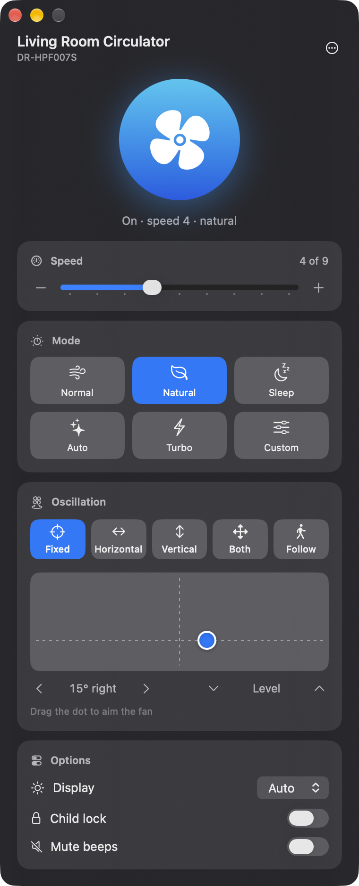
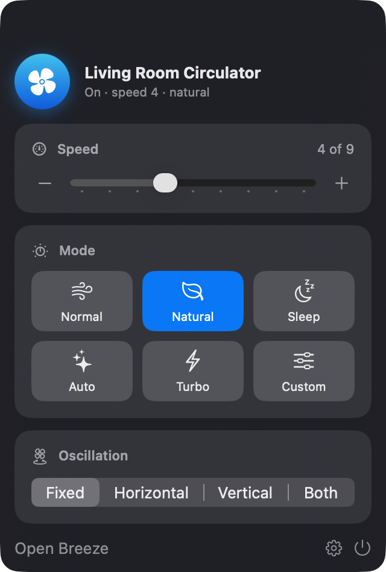

# Breeze for Dreo

A native macOS app to control your Dreo fans from your Mac.
Unofficial: not affiliated with Dreo.

[Español](README.es.md)

<p align="center">
  
  &nbsp;
  
</p>

## Features

- Power, speed and preset modes (Normal, Natural, Sleep, Auto, Turbo, Custom…)
- Oscillation: fixed, horizontal, vertical, both or SmartFollow
- A direction pad that shows where the fan points ("15° right, level") and lets you aim it, set how far it sweeps or how wide it follows you
- Display light, child lock, mute beeps and the other settings your model reports
- Optional menu bar icon with compact controls
- Several fans on one account
- Keyboard shortcuts: ⌘↩ power, ⌘↑ / ⌘↓ speed, ⌘R refresh. Click the direction pad and use the arrow keys to aim in 5° steps (Shift for 15°)
- English and Spanish, following your Mac's language
- Your login stays in the macOS Keychain

## Requirements

- macOS 15 Sequoia or later (Apple silicon or Intel)
- A Dreo account with your fan already set up in the Dreo phone app
- Internet: Breeze talks to Dreo's cloud, like the phone app does

## Install

### Download

1. Download the latest `Breeze-for-Dreo-x.y.z.zip` from [Releases](https://github.com/rodartej/breeze-for-dreo/releases).
2. Unzip it and drag **Breeze for Dreo** to your Applications folder.
3. Breeze isn't notarized by Apple, so macOS blocks it the first time. Open it once, then go to **System Settings → Privacy & Security** and click **Open Anyway**. Or run:

   ```bash
   xattr -dr com.apple.quarantine "/Applications/Breeze for Dreo.app"
   ```

### Build from source

You need Xcode or the Command Line Tools (`xcode-select --install`). No Xcode project is involved.

```bash
git clone https://github.com/rodartej/breeze-for-dreo.git
cd breeze-for-dreo
make install
```

## Signing in

Use the email and password of your Dreo app account.

**Signed up with Google or Apple?** Dreo only lets other apps sign in with an email and password. You can add a password to the same account and keep using Google or Apple in the phone app. In the Dreo app, go to **Profile → your name → Account Security → Change Login Password** ([Dreo's guide](https://support.dreo.com/cs/article/create-password-in-app)). Breeze shows these steps under **I use Google to sign in**.

## Window, Dock and menu bar

By default Breeze is a regular app: it has a window and a Dock icon, and closing the window quits it. Your fan keeps whatever you set, because the settings live on the fan.

Turn on **Settings (⌘,) → Show in menu bar** to keep Breeze in the menu bar. Closing the window then leaves it running there and out of the Dock. Click the icon for quick controls, or **Open Breeze** to bring the window back. Opening Breeze from Spotlight, Alfred or Applications also brings the window back.

**Open at login** starts Breeze when you log in.

## Privacy and security

- Breeze only talks to Dreo's servers (`open-api-us.dreo-tech.com` or `open-api-eu.dreo-tech.com`). These are the same servers Dreo's official Home Assistant integration uses.
- Breeze never stores your password. Dreo's API takes an MD5 hash of it, and Breeze keeps that hash in your Keychain. The hash works as a login for Dreo's API, so treat it like a password. **Sign Out** deletes it.
- No analytics or tracking. A local log at `~/Library/Logs/Breeze for Dreo.log` helps with debugging. It includes device details (model, serial number, state) but no credentials.

## Supported devices

Breeze controls any Dreo device that the cloud reports as a fan: tower, pedestal, air circulator or ceiling fan. Speeds, modes and options come from Dreo's settings for each model, so new models usually just work. It has been tested with the DR-HPF007S air circulator.

Heaters, humidifiers and air purifiers aren't supported yet. If your fan misbehaves, [open an issue](https://github.com/rodartej/breeze-for-dreo/issues) with its model and the `device:` line from the log. Remove the serial number first if you prefer.

## Troubleshooting

- **After an update, macOS asks to let Breeze use your keychain:** Breeze isn't signed with an Apple developer certificate, so macOS asks once after each new build. Click **Always Allow**.
- **"Can't reach Dreo":** check your internet connection. Dreo also limits how often apps can call it, so if you see "Too many requests", wait a moment.
- **"Offline: check the fan's Wi-Fi":** the fan isn't connected to Dreo's cloud. Check it in the Dreo app.

## Development

```
Sources/
  API.swift        Dreo cloud client and the demo backend
  Store.swift      app state, command queue, Keychain
  Views.swift      main window
  MenuBar.swift    menu bar panel and Settings
  BreezeApp.swift  scenes, menus, Dock and menu bar behavior
Resources/         Info.plist, icon, translations (*.lproj)
Tests/             store tests against the demo backend
scripts/           build, test, translation check and icon generator
```

| Command        | What it does                                         |
| -------------- | ---------------------------------------------------- |
| `make`         | Builds `.build/Breeze for Dreo.app` for this Mac     |
| `make install` | Builds, installs to `/Applications` and opens it     |
| `make demo`    | Runs the app with fake fans (no account needed)      |
| `make test`    | Runs the tests against the demo backend              |
| `make strings` | Lists text that's missing a translation              |
| `make release` | Universal build plus zip, as published on GitHub     |

### How it works

Breeze uses Dreo's open API, as found in Dreo's own open-source [hass-dreoverse](https://github.com/dreo-team/hass-dreoverse) and [pydreo-cloud](https://github.com/dreo-team/pydreo-cloud). It signs in with your email and the MD5 of your password, then loads your device list. The list includes what each model supports. Breeze then reads the fan's state and sends `control` requests with the values you want. Commands go out one at a time, in order. The window updates right away and checks with the cloud two seconds later.

### Adding a language

1. Copy `Resources/es.lproj` to `Resources/<code>.lproj` and translate the values. The keys are the English text.
2. Add the code to `CFBundleLocalizations` in `Resources/Info.plist`.
3. Run `make strings` to check that nothing is missing.

### Releasing

Bump `CFBundleShortVersionString` in `Resources/Info.plist`, update `CHANGELOG.md`, then push a matching tag (`v1.0.1`). GitHub Actions builds the universal app and attaches the zip to the release.

## Contributing

Issues and pull requests are welcome. Please run `make test` and `make strings` before opening a pull request.

## Disclaimer

Breeze is an independent project. "Dreo" is a trademark of its owner. Breeze is not affiliated with, endorsed by or sponsored by Dreo. Use it at your own risk.

## License

[MIT](LICENSE)
